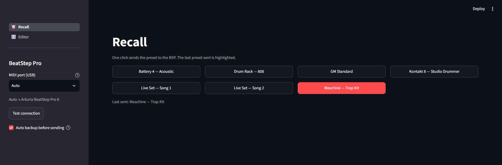
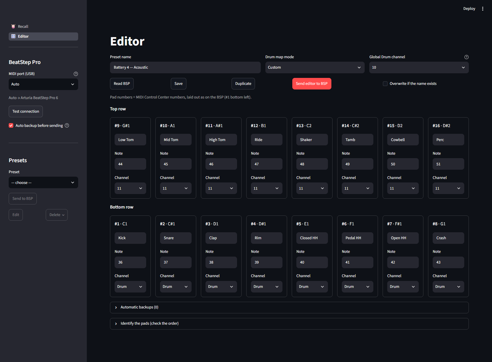

# bsp-drummap

*English version. Version française : [READMEvf.md](READMEvf.md).*

Save and recall Arturia BeatStep Pro drum maps in one click (Drum mode, firmware 2.x).
A preset holds the drum map mode, the global Drum channel and, for each of the 16 pads,
the note, the channel and a label. Presets are sent over USB SysEx through
[beatstep-pro-handler](https://github.com/jamisonx-dev/beatstep-pro-handler).

## Installation (Windows 11)

- Install [uv](https://docs.astral.sh/uv/), then run `uv sync` in this folder.
  uv fetches Python 3.12: the version is pinned because python-rtmidi 1.5.8 has no wheel
  for Python 3.13 and later (it would need an MSVC build).
- Connect the BSP over **USB**: the BSP ignores configuration SysEx received on the DIN ports.
- Keep MIDI Control Center **closed** while sending.
- If `uv sync` cannot find beatstep-pro-handler on PyPI, replace the dependency in
  `pyproject.toml` with `beatstep-pro-handler @ git+https://github.com/jamisonx-dev/beatstep-pro-handler`.

## Usage

| Command | Effect |
| --- | --- |
| `uv run invoke ui` | opens the interface in the browser |
| `uv run invoke send maschine` | recalls a preset without opening the interface |
| `uv run invoke dump "Kontakt 8"` | saves the current BSP state as a preset |
| `uv run invoke presets` | lists the presets and the automatic backups |
| `uv run invoke ports` | lists the MIDI ports and the one "Auto" would pick |
| `uv run invoke test` | runs the tests (simulated BSP, no hardware needed) |

The interface is only reachable from this computer (http://localhost:8501) and uses a dark theme.
It has two pages:

- **Recall**: one button per preset; one click sends it to the BSP. The last preset sent is highlighted.
- **Editor**: create and edit presets in a grid laid out like the BSP
  (pad #1 bottom left, #9 right above it), automatic backups, pad identification.





Every send first reads the BSP and keeps its state in `presets/_backups/` (last 10),
then reads back the written parameters to check that they stuck.

## First run (once)

1. `uv run invoke ports`: the BSP must show up. Otherwise, pick its port by hand in the interface.
2. In the interface, **Test connection** must show the mode and the Drum channel.
3. On the **Editor** page, **Read BSP**: the grid must show the same values as MCC
   (pad #1 = 60 … pad #13 = 72, channel 10). If so, the mapping between parameters and MCC numbers
   is confirmed. Name this drum map (for example "Before") and **Save**.
4. **Identify the pads**: **Load identification preset**, **Send editor to BSP**, switch the BSP to DRUM mode,
   click **Listen** and hit the pads left to right, bottom row then top row.
   The table tells which number each physical pad carries and whether the channels follow the same order.
5. If the physical layout differs from the grid, fix `GRID_ROWS` in `src/bsp_drummap/layout.py`
   (the only place to change).
6. Restore your setup: recall the "Before" preset from the **Recall** page, or restore the most recent backup.
7. Power the BSP off and on, then **Read BSP** again: the drum map you sent must still be there.

## Preset format

One JSON file per preset in `presets/`, one pad per line, easy to edit by hand:

```json
{"pad": 1, "note": 36, "channel": 10, "label": "Kick"}
```

`channel` is 1 to 16, or `"drum"` to follow the global Drum channel. An empty or missing label
becomes `Pad-1` … `Pad-16`. Note names follow the Native Instruments convention (C3 = 60).
The `BSP_PRESETS_DIR` environment variable lets you store presets elsewhere (a synced folder, for example).

## Good to know

- beatstep-pro-handler is a young project and its Drum side is lightly tested: hence the verification
  read-back after every send.
- The BSP drops replies when it receives too many read requests at once: reads are sent
  in groups of 2 (`READ_CHUNK` in `src/bsp_drummap/device.py`).
- Outside Custom mode, the BSP ignores per-pad settings: only the mode and the Drum channel are sent.
- With Windows MIDI Services (multi-client), Maschine can stay open while sending.
  Without it, close the applications that hold the BSP port.
